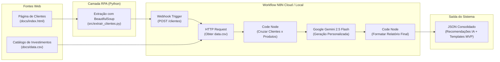

# Assistente de Investimentos com RPA e IA Generativa (DIO Lab)

Este projeto implementa um pipeline inteligente de automação que combina técnicas de **RPA (Robotic Process Automation)** em Python, orquestração de workflows no **N8N** e **IA Generativa (Google Gemini)** para gerar recomendações de investimentos personalizadas com base no perfil e saldo de cada cliente.

---

## 🏛️ Arquitetura da Solução



---

## 📦 Componentes do Projeto

| Componente | Ferramenta | Descrição |
| :--- | :--- | :--- |
| **Página de Clientes** | HTML / GitHub Pages | Tabela com clientes fictícios contendo nome, email, saldo e perfil de risco. |
| **Catálogo de Investimentos** | CSV | Tabela de produtos financeiros (`Poupança`, `CDB`, `Tesouro`, `Ações`, `FIIs/ETFs`, `Cripto`) com aportes mínimos e rentabilidade. |
| **Robô de Coleta (RPA)** | Python + BeautifulSoup | Extrai dinamicamente os clientes da página e dispara o payload JSON para o N8N. |
| **Orquestrador de Fluxo** | N8N Workflow | Coordena o recebimento do webhook, leitura do catálogo, cruzamento de regras e chamada à IA. |
| **IA Generativa** | Google Gemini | Atua como consultor financeiro virtual, gerando mensagens empáticas, claras e sob medida para cada investidor. |

---

## 📂 Estrutura de Arquivos

```
📁 dio-lab-assistente-investimentos-rpa-n8n/
├── 📄 README.md                    # Documentação completa da solução
├── 📁 src/
│   ├── 📄 extrair_clientes.py      # Script Python standalone para execução local ou automação
│   └── 📄 extrair_clientes.ipynb   # Notebook interativo para execução no Google Colab
├── 📁 n8n/
│   └── 📄 workflow.json            # Workflow exportado do N8N pronto para importação
└── 📁 docs/
    ├── 📄 index.html               # Página web simulada de clientes
    └── 📄 data.csv                 # Tabela com as opções de investimento
```

---

## ⚙️ Como Executar o Projeto

### 1. Importar o Workflow no N8N
1. Acesse sua instância do **N8N** (Cloud ou Docker local).
2. Vá em **Workflows** > **Add Workflow** > menu **...** > **Import from File**.
3. Selecione o arquivo `n8n/workflow.json`.
4. Ative o workflow (**Publish** / **Active**).
5. O Webhook ficará disponível na rota `/webhook/clientes`.

### 2. Executar o Script RPA em Python

#### Opção A: Executar via Terminal / Local
```bash
pip install requests beautifulsoup4
python src/extrair_clientes.py
```

#### Opção B: Executar via Google Colab
1. Abra o arquivo `src/extrair_clientes.ipynb` no [Google Colab](https://colab.research.google.com/).
2. Execute a célula de instalação de dependências.
3. Ajuste a variável `N8N_WEBHOOK` com a URL do seu Webhook (se estiver usando instância própria).
4. Execute as células sequencialmente para ver a extração e a resposta da IA.

---

## 🎯 Exemplos de Recomendações Geradas

### Exemplo 1: Perfil Conservador
* **Cliente:** Ana Silva (Saldo: R$ 12.500,00)
* **Mensagem da IA (Gemini):**
> *"Olá Ana Silva, esperamos que esteja bem! Como sua consultora de investimentos aqui no banco digital, notei que, com seu perfil conservador e um saldo disponível de R$ 12.500,00, temos ótimas opções para você começar a investir com segurança e rentabilidade, preservando seu capital.*
> 
> *Gostaria de destacar duas alternativas que superam a Poupança: o **Tesouro Selic** (com aplicação mínima de R$ 500,00 e rentabilidade de 13,0%) e o **CDB Liquidez Diária** (a partir de R$ 1.000,00 e 12,5% de rentabilidade com resgate imediato).*
> 
> *Ambas proporcionam segurança sólida e rendimento acima da inflação. Você pode simular e aplicar diretamente pelo nosso aplicativo!"*

### Exemplo 2: Perfil Moderado
* **Cliente:** Henrique Alves (Saldo: R$ 22.300,00)
* **Mensagem da IA (Gemini):**
> *"Olá, Henrique! Como seu consultor financeiro dedicado, analisei seu saldo de R$ 22.300,00 e seu perfil Moderado. Destacamos três opções equilibradas: o **CDB Prefixado (14% a.a.)** para previsibilidade, o **Fundo Multimercado (16% a.a.)** com gestão profissional para impulsionar retornos, e o **Tesouro IPCA+ (IPCA + 6%)** para blindar seu patrimônio contra a inflação.*
> 
> *Fico à disposição para esclarecer qualquer dúvida ou você pode ativar essas aplicações pelo app!"*

### Exemplo 3: Perfil Arrojado
* **Cliente:** João Pereira (Saldo: R$ 15.000,00)
* **Mensagem da IA (Gemini):**
> *"Olá, João! Notamos seu perfil Arrojado e o saldo de R$ 15.000,00 disponível para investir. O **Fundo de Ações** se mostra uma excelente opção para diversificar com gestão profissional a partir de R$ 10.000. Além disso, as **Ações ETF** e as **Criptomoedas** complementam sua estratégia para buscar alta valorização.*
> 
> *Convidamos você a explorar essas opções no aplicativo do Banco Digital!"*

---

## 🏆 Entregáveis Atendidos

- [x] **RPA em Python**: Extração via BeautifulSoup conectada ao Webhook do N8N.
- [x] **Workflow N8N**: Fluxo completo com Webhook, requisição HTTP do CSV, regras de negócios e tratamento de dados.
- [x] **MVP**: Geração de templates padronizados por perfil (`mensagem_estatica_mvp`).
- [x] **Desafio com IA Generativa**: Integração com Google Gemini gerando recomendações inteligentes, empáticas e personalizadas com base no saldo real e produtos elegíveis.
- [x] **Exportação**: Arquivo `n8n/workflow.json` validado e testado ponta a ponta.
